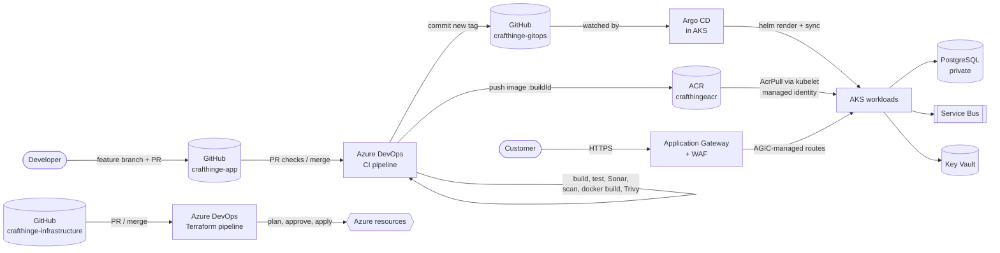
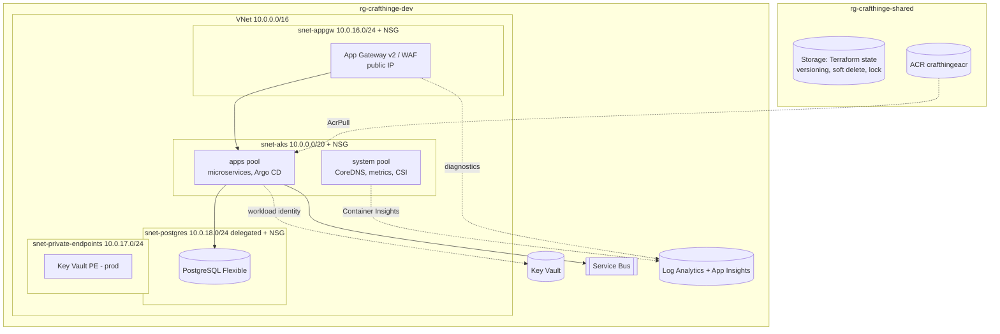

# Phase 1: Foundation (architecture, repositories, branching, protection)

## 1. End-to-end architecture



Two independent delivery paths, which is the core of the interview story:

| | Infrastructure CI/CD | Application CI/CD |
|---|---|---|
| Source | `crafthinge-infrastructure` | `crafthinge-app` |
| Engine | Azure DevOps Terraform pipeline | Azure DevOps CI → GitOps repo → **Argo CD** |
| Changes | VNets, AKS, ACR, Key Vault, App Gateway, DB... | Container images, replicas, config |
| Gate | Manual approval on the plan | PR review on GitOps repo (QA/PROD) |
| Rollback | Revert the Terraform PR and re-apply | `git revert` the tag commit, Argo CD syncs |
| Frequency | Weekly-ish | Many times per day |

**Why Azure DevOps never runs `kubectl`/`helm` against AKS:** the cluster *pulls* its state from Git, so the CI system holds no cluster credentials. That means a compromised pipeline can't deploy to prod, every deployment is a Git commit (audit trail + rollback), and the AKS API server can be IP-restricted to admins only.

## 2. Azure resource architecture (per environment)



| Environment | VNet | Cluster | Notes |
|---|---|---|---|
| dev | 10.0.0.0/16 | own AKS, Free tier | no zones, scales to small sizes, destroy when idle |
| qa | 10.1.0.0/16 | own AKS | 2 zones, WAF in Detection |
| prod | 10.2.0.0/16 | own AKS (ideally own subscription) | 3 zones, Standard tier SLA, WAF Prevention, private Key Vault, HA Postgres |

Non-overlapping CIDRs mean the VNets can later be peered to a hub (VPN, self-hosted agents) without re-IPing.

## 3. Repositories

```
GitHub
├── crafthinge-app              application source (services + frontend)
├── crafthinge-gitops           desired Kubernetes state, watched by Argo CD
└── crafthinge-infrastructure   Terraform + Terraform pipeline (this repo)
```

Why three repos instead of one:
- **Different change rates and reviewers.** App devs merge many times a day; infra changes need platform review.
- **No CI loop.** If the pipeline committed image tags into the app repo, every tag commit would trigger another build.
- **Least privilege.** The CI pipeline can write to `crafthinge-gitops` (DEV only) but never to infra.
- **Clean audit.** `git log` on the GitOps repo *is* the deployment history.

## 4. Branching strategy

```
crafthinge-app
main ───────────●───────────────●─────────   releases (promoted to QA → PROD)
                ↑ PR (release)  ↑
develop ──●──●──┴──●──●──●──────┴─────────   integration; every merge auto-deploys to DEV
          ↑  ↑     ↑
feature/order-service, feature/payment-service, ...   short-lived, deleted after merge
```

| Event | What runs |
|---|---|
| PR → `develop` | CI: build, unit tests, Sonar, scans (no image push) |
| Merge → `develop` | CI + Docker build + push `:<buildId>` + commit tag to `environments/dev` |
| PR `develop` → `main` | Release review |
| Promotion to QA/PROD | PR in `crafthinge-gitops` copying the **same tag** already tested in DEV (no rebuild) |
| Hotfix | `hotfix/*` from `main`, PR to `main`, then merged back into `develop` |

`crafthinge-infrastructure` and `crafthinge-gitops` use plain trunk-based flow: short branches → PR → `main`.

## 5. Branch protection (GitHub rulesets)

Applied by `scripts/github-branch-protection.sh`:

| Rule | app (`main`,`develop`) | infra (`main`) | gitops (`main`) |
|---|---|---|---|
| PR required, 1 approval | ✅ | ✅ | ✅ |
| CODEOWNER review | ✅ | ✅ | ✅ (prod paths need release managers) |
| Stale approvals dismissed / last push approved | ✅ | ✅ | ✅ |
| Required status check | CI pipeline | Terraform plan | - |
| No force push / deletion, linear history | ✅ | ✅ | ✅ |
| Bypass | nobody | nobody | **CI deploy key only** (DEV tag commits) |

Connecting GitHub to Azure DevOps: install the **Azure Pipelines GitHub App** on the three repos. PR builds then report back as GitHub status checks, which is what the "required status check" rule enforces.
